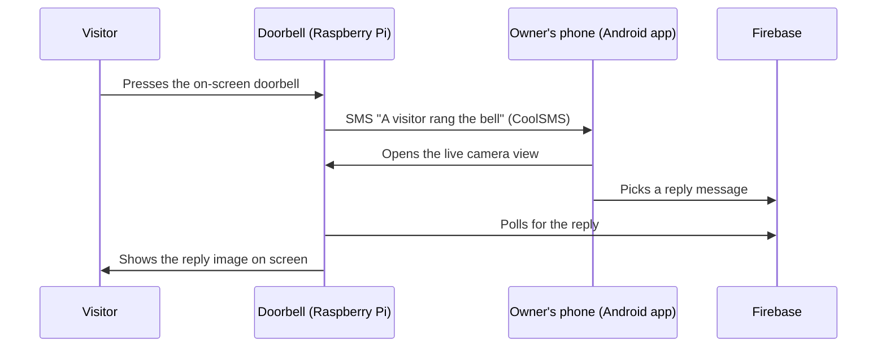

# Knock Knock Man — Smart Doorbell


A smart doorbell that won the **Top Excellence Award (최우수상) at the 2016 Samsung Junior Software Cup**.
When a visitor presses the doorbell, the owner gets a text message, checks the visitor
on their phone, and sends back a reply that appears on the doorbell's screen.

## Motivation

I built Knock Knock Man for my older brother, a former athlete who uses a wheelchair.
Getting to the front door every time someone rang the bell was hard for him, so I wanted
him to be able to see who was there and answer from his phone, wherever he was in the house.
What started as a tool for him turned out to be useful for the rest of my family and our neighbors as well.

## Awards & Press

- 🏆 **Top Excellence Award (최우수상)** — Samsung Junior Software Cup (삼성 주니어 SW 창작대회), 2016
- 📰 Samsung Newsroom Korea (2021): ["내 아이디어를 현실로" 개발자 꿈나무 3인이 말하는 삼성 주니어 SW 창작대회](https://news.samsung.com/kr/%eb%82%b4-%ec%95%84%ec%9d%b4%eb%94%94%ec%96%b4%eb%a5%bc-%ed%98%84%ec%8b%a4%eb%a1%9c-%ea%b0%9c%eb%b0%9c%ec%9e%90-%ea%bf%88%eb%82%98%eb%ac%b4-3%ec%9d%b8%ec%9d%b4-%eb%a7%90%ed%95%98) — interview about this project (featured as 녹녹맨)

## How it works



## Repository layout

| Folder | What it is |
|---|---|
| `doorbell/` | Raspberry Pi side — full-screen Tkinter UI (`button.py`), SMS alert (`cctv_send_sms.py`), camera capture and Dropbox upload, reply images |
| `app/` | Android Studio project for the owner — receives the SMS, shows the camera feed, sends replies through Firebase |

## Setup

### Doorbell (Raspberry Pi)

1. Copy `doorbell/` to `/home/pi/KnockMan/` (paths in the code assume this location).
2. Install dependencies: `python-firebase`, `Pillow`, the CoolSMS Python SDK,
   [Dropbox-Uploader](https://github.com/andreafabrizi/Dropbox-Uploader), `raspistill`, `mplayer`.
3. Create your secrets file and load it before running:

```bash
cp .env.example .env      # then fill in your own keys and phone numbers
set -a; . ./.env; set +a  # export every variable in .env
python doorbell/button.py
```

### Android app

1. Open `app/` in Android Studio.
2. Download `google-services.json` from your own Firebase project and place it in `app/app/`.
3. Set `piAddr` in `MainActivity.java` to the Raspberry Pi's address on your network.

> [!NOTE]
> API keys, phone numbers and the Firebase config are not included in this repository.
> See `.env.example` for the variables the doorbell needs.
